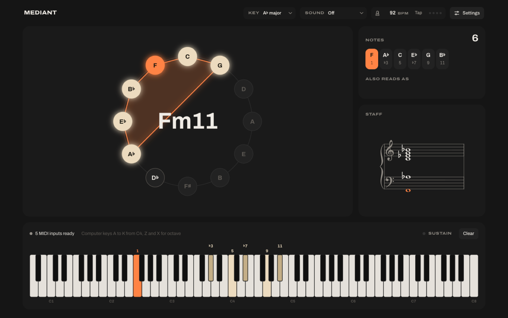

# Mediant

Plug in a MIDI keyboard and see what you play: the chord name, the notes on a keyboard and staff, and the chord's shape on the circle of fifths.

Open it at https://kjdotio.github.io/mediant/ in Chrome, Edge or Firefox. Safari can't read MIDI keyboards.



## What it does

- Names chords as you play, with slash chords, extensions and inversions, and spells every note for the chord or the key you pick.
- Lights the chord on a circle of fifths, a grand staff and an 88-key keyboard labelled with intervals or note names.
- Follows the sustain pedal, holds the last chord when you let go, and works with your computer keyboard when no MIDI keyboard is connected.
- Plays a built-in felt, upright or grand piano, and has a metronome with tap tempo.

Everything runs in your browser. There's no account and no server, and the chord naming is rule-based, not AI.

## Packages

- `apps/web`: the web app (Vite and React).
- `packages/theory`: the theory engine. It names chords from held MIDI notes, spells each note, labels intervals and gives Roman numerals in a key.

## Develop

You need Node.js 22 or later.

```sh
npx -y pnpm@11.5.3 install
npx -y pnpm@11.5.3 --filter @mediant/web dev
npx -y pnpm@11.5.3 test
npx -y pnpm@11.5.3 typecheck
```

Every push to `main` runs the checks and deploys to GitHub Pages.

## Sounds

The built-in pianos come from free sample libraries. Each pack in `apps/web/public/sounds` has its own `LICENSE.txt`.

- Felt Piano: Fuchs & Möhr Felt Piano by Tom Guder, public domain.
- Upright Piano and Grand Piano: Versilian Community Sample Library by Versilian Studios, CC0 1.0.

`scripts/build-sounds.mjs` rebuilds the packs. It needs macOS, because it encodes with `afconvert`.

## Licence

The code is MIT. See `LICENSE`. The sample packs keep their own licences, listed above.
